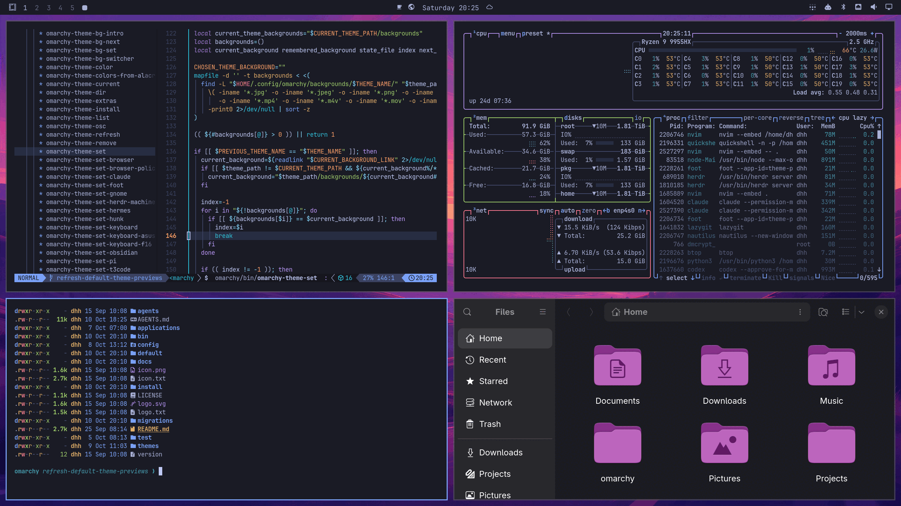

# <h1 align="center">Hi, I'm Renaud 👋</h1>

  

  
  
  

  

  

---

<h3 align="center">About Me</h3>

I'm a computer science student. Cybersecurity is my main field, and I also like data science.
*   Now: M1 Cryptis (cryptology and information security) at the University of Limoges.
*   Before: BUT Informatique (2025), then a Licence Informatique (L3) at Limoges.
*   I like digging into system vulnerabilities and network security.
*   Data science comes second, mostly for dev/psychology questions and human behavior seen through data.

---

<h3 align="center">🌱 Currently Learning</h3>

  
  
  
  

---

<h3 align="center">Professional Experience</h3>

*   SAFRAN, intern (2023): built automation solutions with UiPath (RPA).
*   Camping website, web developer intern (2024): built and maintained web features in PHP.

---

<h3 align="center">Skills & Tools</h3>

<h4 align="center">Programming Languages</h4>

  
  
  
  
  
  
  
  
  

<h4 align="center">AI Coding Tools</h4>

  
  
  

<h4 align="center">Tools & Technologies</h4>

  
  
  
  
  
  
  
  

<h4 align="center">Operating Systems & Environment</h4>

  
  
  
  

> ### 💙 I live on [Omarchy](https://omarchy.org)
> Omarchy (Arch + Hyprland) is my daily driver and I'm attached to it. I like the tiling, keyboard-driven workflow and I tweak it to my taste. I also keep a fork of [omarchy-tray](https://github.com/RAbdGen/omarchy-tray), a system tray for it.

  
   
  Omarchy with the Tokyo Night theme (screenshot from the <a href="https://github.com/omacom/omarchy">official repo</a>, MIT license)

*   I'm comfortable on most Linux distributions (Arch, Debian/Ubuntu, KDE...).
*   I also know Windows well enough for development and testing.

---

<h3 align="center">Notable Projects</h3>

<table>
  <tr>
    <td width="50%">
      <h4>Jukebox RPG</h4>
      
Desktop app for tabletop RPG sessions. A track can have several versions (<i>calm</i>, <i>combat</i>, <i>tension</i>...) and the GM crossfades between them without losing the beat. Built with Electron and Node.js.

      <a href="https://github.com/RAbdGen/JukeBox_DnD">Repository</a>
    </td>
    <td width="50%">
      <h4>Video Games & Violence in the USA</h4>
      
Data science study of public data on video games and violence in the USA, done for a school project.

      <a href="https://github.com/RAbdGen/Analyse-Jeux-video-Violence-USA">Repository</a>
    </td>
  </tr>
  <tr>
    <td width="50%">
      <h4>LL(1) Parser</h4>
      
LL(1) syntax analyzer for a mini C-like language, written in Python as a pushdown automaton.

      <a href="https://github.com/RAbdGen/compilation_LL1_parser">Repository</a>
    </td>
    <td width="50%">
      <h4>Legrand Web App</h4>
      
A web application for Legrand, built during my BUT.

      
    </td>
  </tr>
  <tr>
    <td width="50%">
      <h4>Network Infrastructure</h4>
      
Complex network setups built with Kathara.

      
    </td>
    <td width="50%"></td>
  </tr>
</table>

---

<h3 align="center">GitHub Stats</h3>

  
  

  

---

<h3 align="center">Connect with me</h3>

  
  
  

